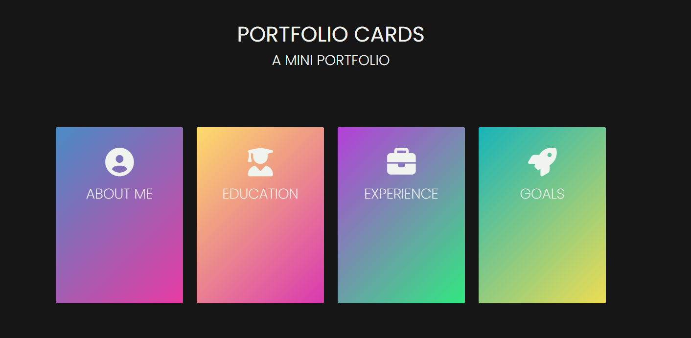

# portfolio-cards

A mini portfolio page showcasing four cards: About me, Education, Experience, and Goals.

## Features

- Flip cards with front and back content
- Randomize card colors using the "Randomize" button
- Simple and clean layout

## Technologies used

- HTML
- CSS
- JavaScript
- Font Awesome icons

## Screenshot



## How to run

Clone this repository:

```bash
git clone https://github.com/isabellea-f/portfolio-cards
```
